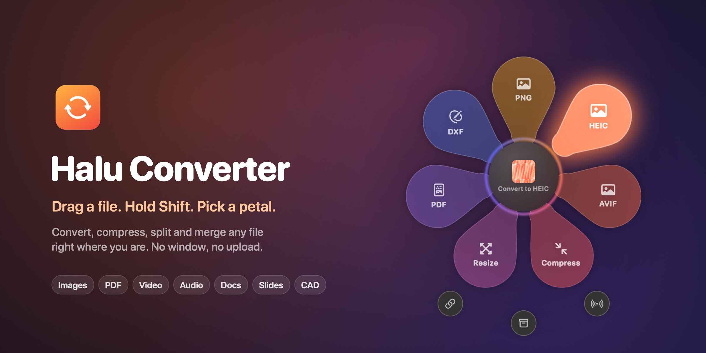
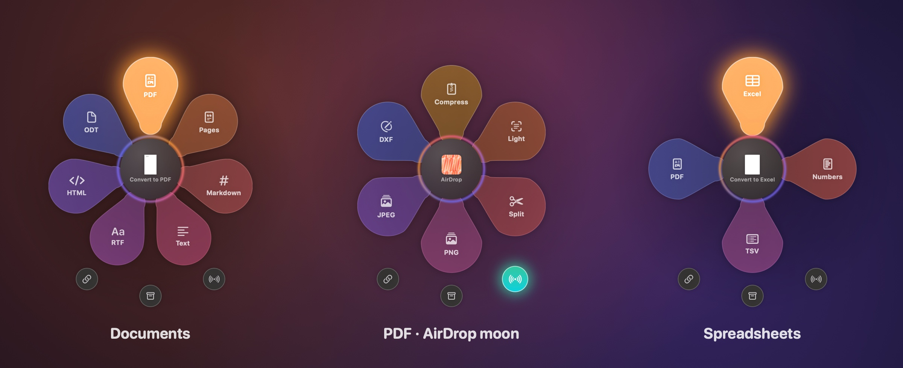
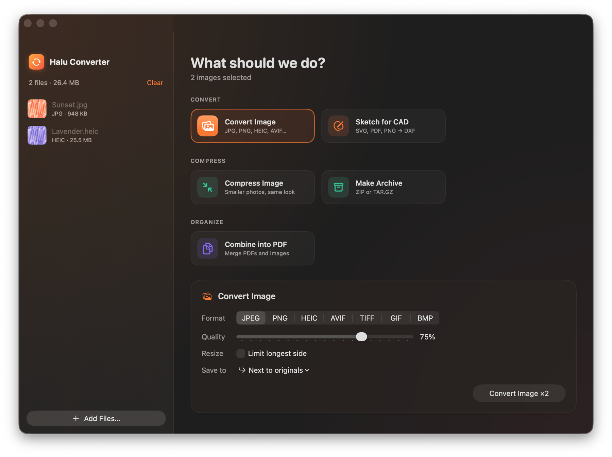

<p align="center">
  
</p>

<p align="center">
  <b>A file converter for macOS that lives in the background.</b><br>
  Drag any file, hold <kbd>⇧ Shift</kbd>, and a flower of actions blooms under the cursor.<br>
  Drop on a petal and the result lands next to the original. No window, no upload, no waiting.
</p>

<p align="center">
  
  
  
  
  
</p>

---

## Why

Converting a file usually means opening an app, finding the right menu, picking a format and hunting for the result. Halu cuts that to one gesture: you're already dragging the file, so the actions come to the cursor. It handles images, PDFs, video, audio, Office and iWork documents, archives, subtitles and even logos for CAD, using only what's built into macOS.

## The flower

<p align="center">
  
</p>

Every file type gets its own petals; the hovered one lifts out and glows, and the core shows which file you're holding and what will happen. The three **moons** below work for any file: **Copy Path**, **ZIP** and **AirDrop**. Drop on the core to open the files in the full window.

**Ways to open it**

| | |
|---|---|
| **Drag + Shift** | Start dragging a file anywhere (Finder, Desktop, Mail…) and hold <kbd>⇧ Shift</kbd>. The key can be changed from the menu bar icon. |
| **Right-click** | **Quick Actions / Services → Convert with Halu**. Click a petal or press <kbd>1</kbd>–<kbd>9</kbd>, <kbd>Esc</kbd> closes. |
| **Open With** | **Open With → Halu Converter** does the same. |

Progress and the result show up in a small card at the bottom of the screen. Click **Show** to reveal the file, or drag the result straight into another app.

<p align="center">
  
</p>

## What it converts

| Files | Petals |
|-------|--------|
| 🖼 **Images** | JPEG, PNG, HEIC, AVIF · compress · resize · to PDF |
| 📄 **PDF** | Compress (two levels) · split pages · pages to PNG/JPEG · merge |
| 🎬 **Video** | 720p · HEVC · MP4 ⇄ MOV · GIF · extract audio |
| 🎧 **Audio** | M4A, FLAC, ALAC, WAV, AIFF, CAF |
| 📝 **Documents** | PDF, Word, Pages, Markdown, Text, RTF, HTML, ODT, DOC |
| 📊 **Slides** | PDF, PowerPoint, Keynote, PNG/JPEG slides |
| 📈 **Spreadsheets** | Excel, Numbers, CSV, TSV, PDF |
| 🗜 **Archives** | Extract ZIP, RAR, 7Z, TAR, GZ · pack folders into ZIP or TAR.GZ |
| 💬 **Subtitles** | SRT, VTT, TXT |
| ✏️ **Logos & drawings** | SVG, PDF, Illustrator (.ai), PNG/JPEG → DXF sketch for CAD |

<details>
<summary><b>DXF sketches for CAD</b></summary>

<br>

DXF sketches open in Shapr3D, Fusion, Onshape and other CAD apps as editable sketches: each closed outline is its own region, ready to extrude. SVG, PDF and .ai keep their exact curves (cubic splines, circles as circles); PNG/JPEG are traced, with the background and up to 8 colours found automatically and sharp corners kept. Options: width in mm, one file / a file per colour / a file per piece, smooth splines or polylines. Text must be converted to outlines first.

</details>

<details>
<summary><b>How iWork and Office files are handled</b></summary>

<br>

Word, RTF, ODT, HTML, Markdown and text convert natively and instantly. Pages, Keynote and Numbers files (and Word → PDF, for the best layout) go through the iWork apps in the background; macOS asks once for permission to control them. Apps that Halu started are quit again after 90 seconds idle, so they don't sit in memory. An app you were already using is left alone.

</details>

## The full window

For batches and detailed settings there's a regular window: menu bar icon → **Open Halu Converter**, or drop files on the flower's core.

<p align="center">
  
</p>

<details>
<summary>Empty state</summary>
<p align="center">
  
</p>
</details>

## Install

Needs macOS 15+ and the Swift toolchain. Command Line Tools are enough, Xcode isn't required.

```bash
xcode-select --install            # once, if you don't have the tools
git clone https://github.com/milalucky/halu-converter.git
cd halu-converter
./build.sh --install              # builds and copies "Halu Converter.app" to /Applications
```

On first launch the app adds itself to Login Items (toggle it from the menu bar icon) and stays in the menu bar, with no Dock icon.

## How it works

- **No permissions needed for the drag gesture.** `DragWatcher` polls the system drag pasteboard and the modifier keys; when a drag carries files and the key is down, a borderless panel opens under the cursor and becomes the drop target.
- **Only Apple frameworks**: PDFKit, ImageIO, AVFoundation, CoreText, AppKit/SwiftUI, plus the built-in `zip`, `tar` and `ditto`. No third-party code.
- **Results never overwrite**: outputs are saved next to the original with a suffix (`photo-compressed.jpg`, `photo-compressed 2.jpg`…).

<details>
<summary><b>Project layout</b></summary>

<br>

| Path | What's there |
|---|---|
| `Wheel.swift` | Drag detection, the floating panel, the petal flower |
| `QuickActions.swift` | Which petals and moons each file type gets |
| `ImageEngine`, `PDFEngine`, `MediaEngine` | Images, PDFs, video and audio |
| `DocumentEngine` | Office/text formats, iWork automation, Markdown |
| `ArchiveEngine` | Archives and subtitles |
| `SketchEngine` → DXF | `SVGImporter`, `PDFVectorImporter` (CGPDFScanner), `Tracer` (bitmap tracing), `Sketch` (geometry, pieces), `DXFWriter` (AC1015, mm) |
| `Toast.swift` | The progress card |
| `AppModel`, `ContentView`, `OptionsCard` | The full window |
| `Scripts/make_readme_art.swift` | Builds the images in this README from screenshots |

</details>

## Contributing

Work in a branch and open a pull request. To add a petal, add a case to `Tool` in `Models.swift` (title, icon, which files it accepts), a branch in `Processor.run`, and the preset in `QuickActions.swift`.
